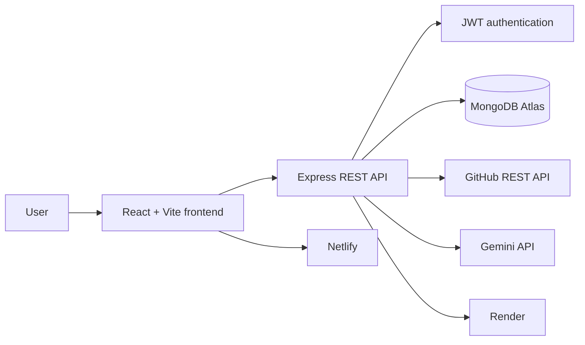
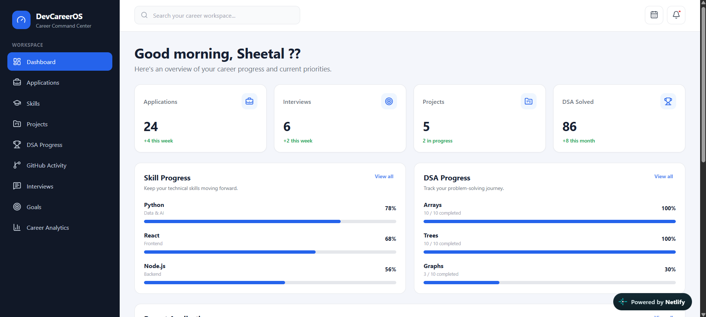
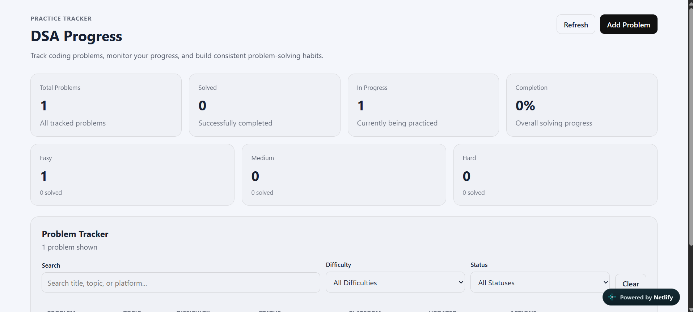
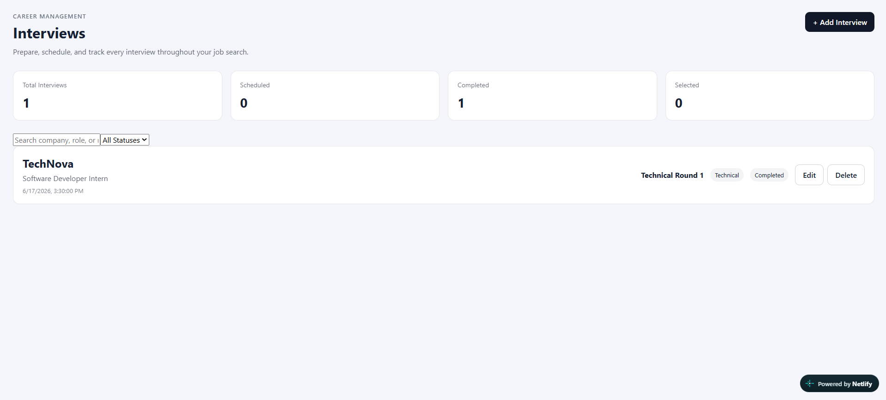
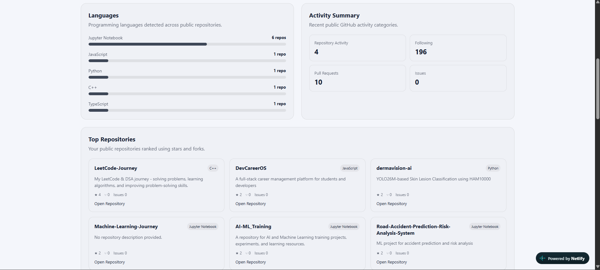
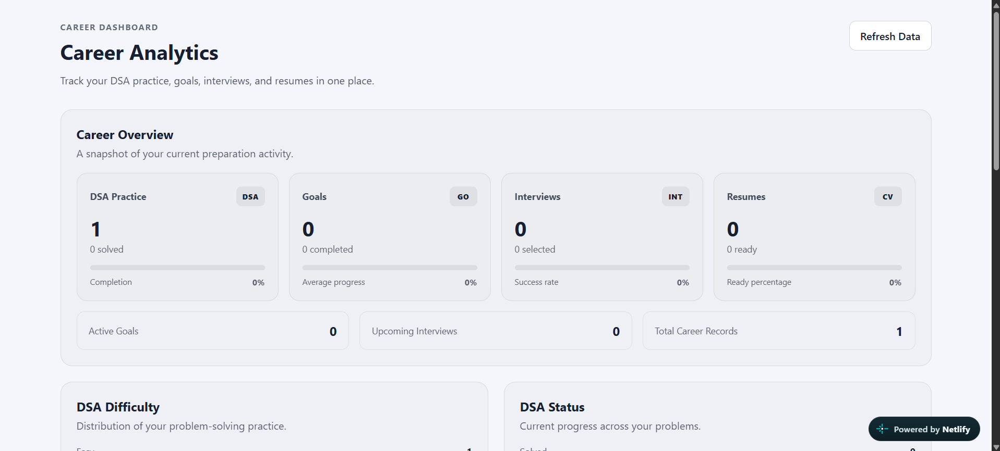
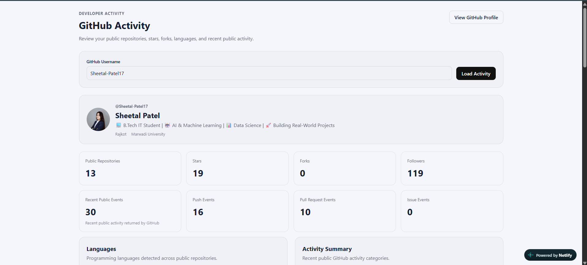
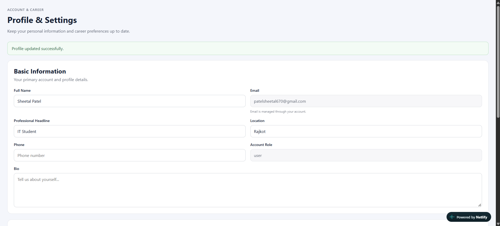

# DevCareerOS

<p align="center">
  <strong>Your career, organized in one workspace.</strong><br />
  A full-stack career management platform for students and early-career developers.
</p>

<p align="center">
  <a href="https://devcareeros.netlify.app"><strong>Live Demo</strong></a>
  ·
  <a href="https://devcareeros-backend.onrender.com/api/health">API Health</a>
  ·
  <a href="https://github.com/Sheetal-Patel17/DevCareerOS">Source Code</a>
</p>

<p align="center">
  
  
  
  
</p>

---

## Overview

**DevCareerOS** brings everyday career-preparation workflows into one authenticated application. Instead of managing job applications, coding practice, interviews, projects, and goals across separate tools, users can organize their progress from a shared dashboard.

The application includes a **Gemini-powered Career AI assistant** for beginner-friendly career guidance, alongside tools for tracking professional development.

## Live Links

| Resource | Link |
| --- | --- |
| Live application | [devcareeros.netlify.app](https://devcareeros.netlify.app) |
| Backend health check | [API health endpoint](https://devcareeros-backend.onrender.com/api/health) |
| GitHub repository | [Sheetal-Patel17/DevCareerOS](https://github.com/Sheetal-Patel17/DevCareerOS) |

> **Hosting note:** The frontend is hosted on Netlify and the API is hosted on Render. Render's free instance may sleep when inactive, so the first request after a quiet period can take longer.

## Features

- **Authentication:** Register and sign in with JWT-based authentication, password hashing, protected routes, and Google OAuth.
- **Career dashboard:** Access career-planning tools from a central workspace.
- **Job applications:** Track applications, companies, roles, statuses, and progress.
- **Skills and learning:** Keep track of technical skills and learning progress.
- **Project manager:** Organize projects and monitor their status.
- **DSA tracker:** Manage coding-practice problems and track progress with search and filtering.
- **Interview tracker:** Organize interview rounds, preparation, schedules, and outcomes.
- **Career goals:** Set goals, deadlines, priorities, milestones, and progress.
- **Resume manager:** Keep track of resume versions and readiness.
- **Career analytics:** Review consolidated progress and status summaries across career modules.
- **GitHub activity:** Explore public GitHub profile information, repositories, stars, forks, languages, and recent public activity.
- **Career AI assistant:** Ask for help with career planning, resume writing, interview preparation, skills, projects, and app usage. The assistant uses Gemini through the backend; the API key stays server-side.
- **Profile and settings:** Maintain professional details and career preferences.
- **Responsive interface:** Navigate the workspace on desktop and mobile screen sizes.

## Tech Stack

| Area | Technologies |
| --- | --- |
| Frontend | React 19, Vite, React Router 7, CSS, Lucide React |
| Backend | Node.js, Express 5, REST API |
| Database | MongoDB Atlas, Mongoose |
| Authentication | JSON Web Tokens (JWT), bcryptjs, Google OAuth |
| AI assistant | Google Gemini API |
| External integration | GitHub REST API |
| Quality and deployment | Git, GitHub Actions, Netlify, Render |

## Architecture



## Project Structure

```text
DevCareerOS/
├── backend/
│   ├── src/
│   │   ├── config/
│   │   ├── controllers/
│   │   ├── middleware/
│   │   ├── models/
│   │   ├── routes/
│   │   └── server.js
│   ├── .env.example
│   └── package.json
├── frontend/
│   ├── public/
│   ├── src/
│   │   ├── components/
│   │   ├── pages/
│   │   ├── services/
│   │   ├── styles/
│   │   ├── App.jsx
│   │   └── main.jsx
│   ├── .env.example
│   └── package.json
├── docs/
│   ├── screenshots/
│   ├── architecture.md
│   ├── GOOGLE_OAUTH_SETUP.md
│   └── roadmap.md
├── .github/workflows/ci.yml
├── netlify.toml
└── README.md
```

## Run Locally

### Prerequisites

- Node.js (use a current LTS release)
- npm
- Git
- A MongoDB Atlas database (or a MongoDB instance you manage)
- A Google OAuth web client ID for Google sign-in
- A Gemini API key if you want to use Career AI locally

### 1. Clone the repository

```bash
git clone https://github.com/Sheetal-Patel17/DevCareerOS.git
cd DevCareerOS
```

### 2. Configure the backend

```bash
cd backend
npm install
```

Create a file named `.env` inside the `backend/` folder. Use `backend/.env.example` as your template:

```env
PORT=5000
MONGODB_URI=your_mongodb_connection_string
JWT_SECRET=replace_with_a_long_random_secret
CLIENT_URL=http://localhost:5173
GOOGLE_CLIENT_ID=your_google_oauth_web_client_id.apps.googleusercontent.com
GEMINI_API_KEY=your_gemini_api_key
GEMINI_MODEL=gemini-3.8-flash
```

Replace the example values with your own credentials. Never commit your real `.env` file or share API keys. The Gemini key belongs only in the backend environment, never in frontend variables.

Start the API:

```bash
npm run dev
```

The backend runs at `http://localhost:5000`. Check its health endpoint at [http://localhost:5000/api/health](http://localhost:5000/api/health).

### 3. Configure the frontend

Open a second terminal at the repository root:

```bash
cd frontend
npm install
```

Create `frontend/.env` using `frontend/.env.example` as a guide:

```env
VITE_API_BASE_URL=http://localhost:5000/api
VITE_GOOGLE_CLIENT_ID=your_google_oauth_web_client_id.apps.googleusercontent.com
```

Run the frontend:

```bash
npm run dev
```

Vite prints the local URL in the terminal (normally [http://localhost:5173](http://localhost:5173)).

### 4. Google OAuth setup

The Google OAuth client ID must be configured for both the backend and frontend. For Google Cloud Console setup and authorized origins, see [Google OAuth Setup](docs/GOOGLE_OAUTH_SETUP.md).

### 5. Career AI setup

Create a Gemini API key in Google AI Studio and set `GEMINI_API_KEY` in the **backend environment only**. Set `GEMINI_MODEL` to a model available to your Gemini API project. The example above uses `gemini-3.8-flash`; model access and free-tier quotas may vary by project and can change.

## Environment Variables

### Backend (`backend/.env`)

| Variable | Purpose |
| --- | --- |
| `PORT` | Local API port (defaults to 5000) |
| `MONGODB_URI` | MongoDB connection string |
| `JWT_SECRET` | Secret used to sign authentication tokens |
| `CLIENT_URL` | Frontend origin allowed by CORS |
| `GOOGLE_CLIENT_ID` | Google OAuth web client ID |
| `GEMINI_API_KEY` | Server-side Gemini API key for Career AI |
| `GEMINI_MODEL` | Gemini model name used by the assistant |

### Frontend (`frontend/.env`)

| Variable | Purpose |
| --- | --- |
| `VITE_API_BASE_URL` | Base URL for the backend API |
| `VITE_GOOGLE_CLIENT_ID` | Google OAuth web client ID used by the frontend |

**Security:** Vite exposes variables prefixed with `VITE_` to the browser. Never put database credentials, JWT secrets, or AI API keys in frontend environment variables.

## API Overview

The backend exposes REST endpoints grouped by feature:

| Prefix | Purpose |
| --- | --- |
| `/api/auth` | Registration, login, and authentication |
| `/api/users` | User-related operations |
| `/api/applications` | Job application tracking |
| `/api/skills` | Skills tracking |
| `/api/projects` | Project management |
| `/api/dsa` | Coding practice |
| `/api/interviews` | Interview tracking |
| `/api/goals` | Career goals |
| `/api/resumes` | Resume management |
| `/api/profile` | Profile and preferences |
| `/api/analytics` | Career progress summaries |
| `/api/github-activity` | Public GitHub activity |
| `/api/assistant` | Gemini-powered Career AI |

Most user-specific endpoints require authentication.

## Screenshots

The screenshots below show key areas of the application. Images are stored in [`docs/screenshots/`](docs/screenshots/).

### Dashboard



### DSA Tracker



### Interview Tracker



### Career Goals



### Career Analytics



### GitHub Activity



### Profile and Settings



## Continuous Integration

GitHub Actions runs the workflow at [`.github/workflows/ci.yml`](.github/workflows/ci.yml) for pushes to `main` and pull requests targeting `main`. The workflow checks backend JavaScript syntax, frontend linting, and the frontend production build.

## Deployment

- **Frontend:** Netlify — [https://devcareeros.netlify.app](https://devcareeros.netlify.app)
- **Backend:** Render — [https://devcareeros-backend.onrender.com](https://devcareeros-backend.onrender.com)
- **Database:** MongoDB Atlas

Set production environment variables in the respective hosting dashboards. Do not store production credentials in the repository. For the backend, configure `MONGODB_URI`, `JWT_SECRET`, `CLIENT_URL`, `GOOGLE_CLIENT_ID`, `GEMINI_API_KEY`, and `GEMINI_MODEL`. For the frontend, configure the production API base URL and Google client ID using the names expected by the Vite app.

## Security Notes

- Keep all real credentials in local environment files or hosting-provider secret settings.
- Never expose `GEMINI_API_KEY`, `JWT_SECRET`, or `MONGODB_URI` to the frontend.
- If a secret is accidentally committed or shared, rotate it immediately.
- The Career AI assistant is a productivity aid; review generated career advice before relying on it.
- Public GitHub activity reflects the public data available through GitHub's API and is not a guarantee of a complete contribution graph.

## Developer

**Sheetal Patel**

- GitHub: [Sheetal-Patel17](https://github.com/Sheetal-Patel17)
- LinkedIn: [sheetal-patel17](https://www.linkedin.com/in/sheetal-patel17/)
- Portfolio: [sheetal-patel-portfolio.netlify.app](https://sheetal-patel-portfolio.netlify.app/)

## License

This project is licensed under the MIT License. See [`LICENSE`](LICENSE) for details.
